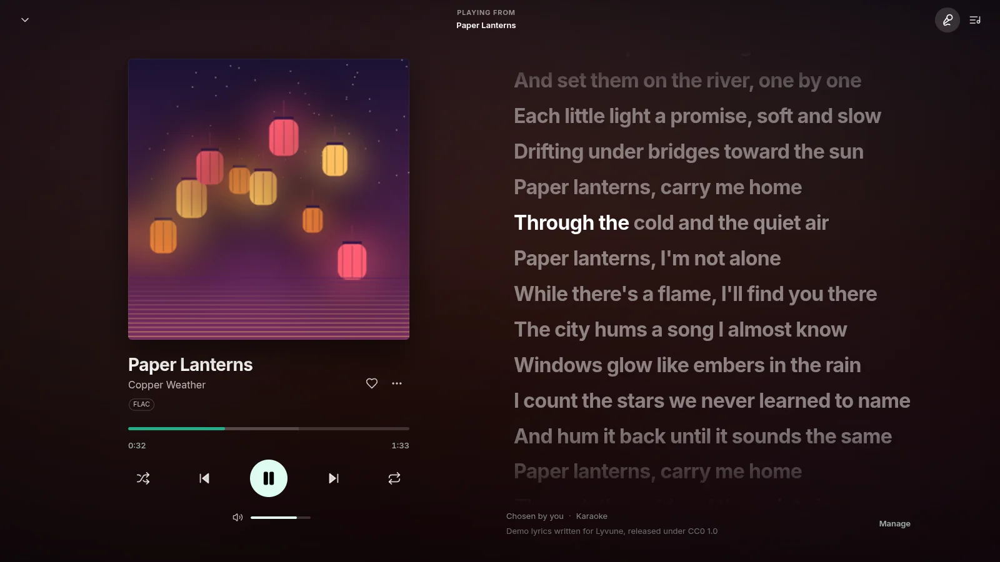
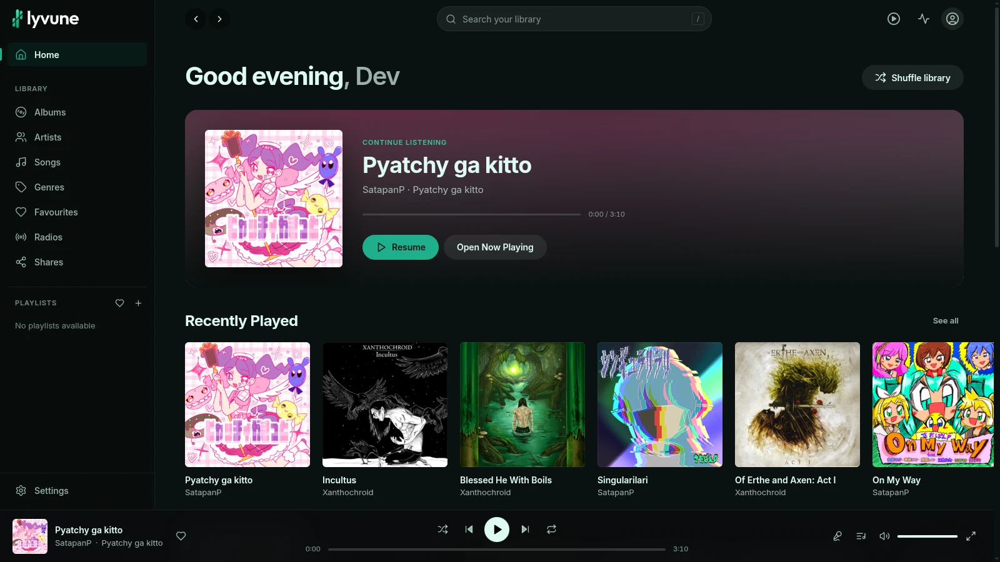
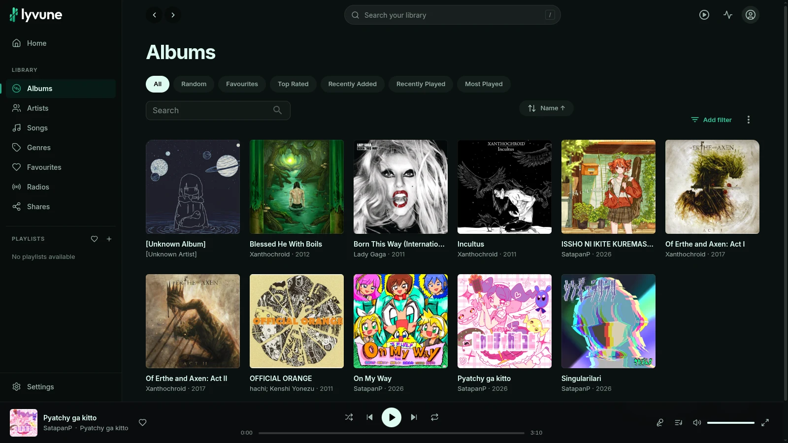
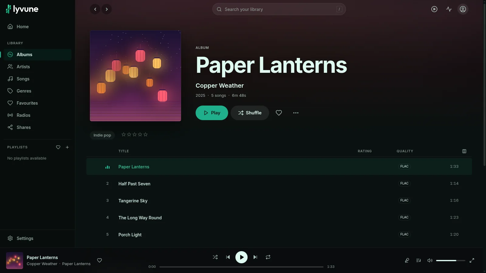
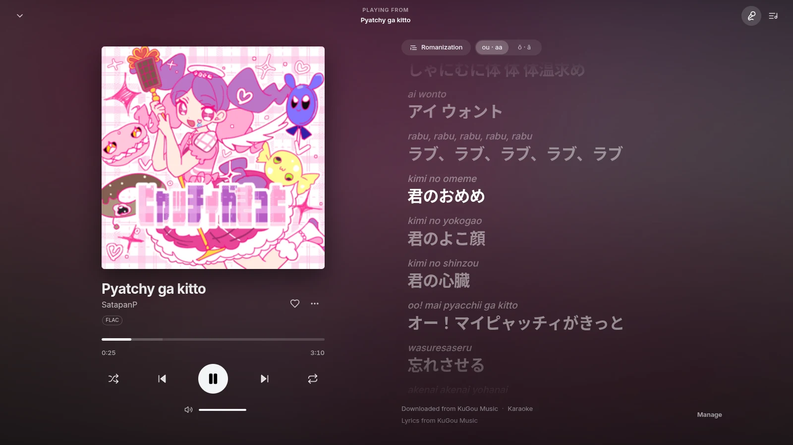
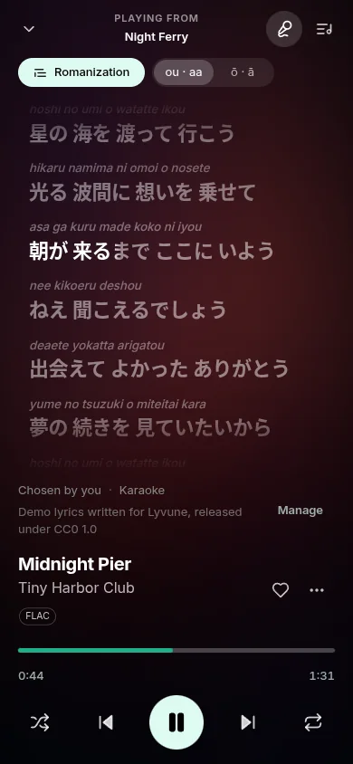

<p align="center">
  <picture>
    <source media="(prefers-color-scheme: dark)" srcset="docs/brand/transparent/logo-horizontal-for-dark-bg.svg">
    
  </picture>
</p>

<h1 align="center">Your music. Fully yours.</h1>

<p align="center">
  <em>A self-hosted music server with a beautiful web player, synchronized karaoke lyrics, and multilingual romanization.</em>
</p>

<p align="center">
  <a href="https://github.com/Tian-MC/lyvune/releases/tag/v0.1.0-alpha.5"></a>
  <a href="LICENSE"></a>
  <a href="https://github.com/Tian-MC/lyvune/pkgs/container/lyvune"></a>
  <a href="https://github.com/Tian-MC/lyvune/actions/workflows/pipeline.yml"></a>
</p>

<p align="center">
  <a href="#get-started"><b>Get started</b></a> &nbsp;·&nbsp;
  <a href="https://github.com/Tian-MC/lyvune/releases/tag/v0.1.0-alpha.5">Download v0.1.0-alpha.5</a> &nbsp;·&nbsp;
  <a href="#features">Features</a> &nbsp;·&nbsp;
  <a href="docs/DOCKER.md">Documentation</a> &nbsp;·&nbsp;
  <a href="https://github.com/Tian-MC/lyvune/discussions">Discussions</a>
</p>

<p align="center">
  
</p>

**Lyvune is a fork of [Navidrome](https://www.navidrome.org).** It keeps Navidrome's server, its Subsonic and
OpenSubsonic API, library scanning and database, and adds a rewritten web interface, a lyrics engine with word-by-word
karaoke, and romanization of lyrics in several scripts. It is free software under the GPL-3.0, with Navidrome's code,
licence and copyright notices kept. See [Credits and licence](#credits-and-licence).

> [!NOTE]
> **This is an alpha** (`v0.1.0-alpha.5`). It works, it is tested, and it will have rough edges. Read the
> [known limitations](#known-limitations) before you trust it with anything you cannot rebuild.

## Features

**A web player you will want to keep open**
- A modern React interface, with two themes: *Lyvune* and *Lyvune Black (OLED)*.
- Playback is not interrupted when you move around the app.

**Word-by-word karaoke**
- Synchronized lyrics, with word timing whenever the source really provides it. Lyvune never invents timing.
- The source of the lyrics is shown under them.

**Multilingual romanization**
- Japanese, Chinese, Korean, Greek, Cyrillic and Arabic lyrics, from one button in the player.
- It is made in your browser and it is approximate: a reading aid, not a transcription.

**A lyrics engine**
- Looks for missing lyrics on LRCLIB and, depending on your settings, KuGou, NetEase and QQ Music, and Musixmatch with
  your own key. Only LRCLIB is on by default.
- Prefers the lyrics files you already have, and lets you override, lock and undo.
- Saves what it finds next to the song as a `.lyrics.json` sidecar file, per provider and under your control. It never
  modifies your audio files.

**Self-hosted, and private by default**
- No usage statistics are sent: the anonymous insights collector is off by default.
- Lyvune asks other services only for what you use (the lyrics providers you enabled, and Deezer for artist
  information). `ND_ENABLEEXTERNALSERVICES=false` turns those lookups off.

**OpenSubsonic compatible**
- Library, search, playlists and streaming through the Subsonic and OpenSubsonic API, and transcoding with ffmpeg.
- Clients that ask for it get word timing: `getLyricsBySongId` with `enhanced=true`.

**Made for Docker**
- Images for `linux/amd64` and `linux/arm64`, a health check, and a server that runs as a normal user, never as root.
- All its data lives in one folder or volume, and it stops cleanly.

## Screenshots

The karaoke view is at the top of this page. The rest of the player. All the screenshots use a demo library, with music,
covers and lyrics created for this project and released under CC0 (see [`scripts/demo-library`](scripts/demo-library/README.md)).

**Home**

<p align="center"></p>

**Albums and playback**

| | |
| --- | --- |
|  |  |
| Browse your albums | An album, with playback controls always at hand |

**Romanization**

| | |
| --- | --- |
|  |  |
| Romanization above each line, with doubled vowels (`ou · aa`) | The same with macrons (`ō · ā`) |

**On your phone**

<p align="center"></p>

## Get started

You need Docker with the Compose plugin, a folder with your music, and a 64-bit computer (`amd64` or `arm64`). The
image is `ghcr.io/tian-mc/lyvune:0.1.0-alpha.5`.

**1. Get the Compose files** for this release:

```sh
git clone --branch v0.1.0-alpha.5 https://github.com/Tian-MC/lyvune.git
cd lyvune
cp .env.example .env
```

**2. Edit `.env`**: set your music folder and tell Compose to use the published image:

```env
LYVUNE_MUSIC_DIR=/path/to/your/music
LYVUNE_IMAGE=ghcr.io/tian-mc/lyvune:0.1.0-alpha.5
```

**3. Start it:**

```sh
docker compose pull
docker compose up -d --no-build
docker compose ps          # wait until it says "healthy"
```

**4. Open <http://localhost:4533>.** The first person to open Lyvune creates the administrator account; then your
library is scanned and the music appears. Your music is mounted read-only. To let Lyvune save lyrics next to your
files, see [Your music and lyrics](docs/DOCKER.md#your-music-and-lyrics).

There is no `latest` tag: always name the version. The [Docker guide](docs/DOCKER.md) covers permissions, a reverse
proxy, backups, [updating and going back](docs/DOCKER.md#updating-and-going-back), and troubleshooting.

### Coming from Navidrome

> [!WARNING]
> Work on a **copy** of your Navidrome data folder, and make a backup first. Lyvune updates the database the first
> time it opens it, and that is one-way: you cannot count on Navidrome opening it again.

Nothing has to be exported or converted. The configuration file is `lyvune.toml`, and a `navidrome.toml` in the same
place is still read when there is no `lyvune.toml`. Environment variables keep their `ND_` prefix. An existing
`navidrome.db` is used as it is (a new installation creates `lyvune.db`), and old `navidrome_backup_*.db` backups are
still listed and pruned. Sidecar files keep the format name `navidrome-lyrics`, so lyrics saved earlier still load.
The server still presents itself to Subsonic clients as `navidrome`, because clients recognise it, and the features it
has, by that name. The steps are in [Coming from Navidrome](docs/DOCKER.md#coming-from-navidrome).

## Known limitations

- **This is an alpha.** Expect bugs, and changes between alphas that are not backward compatible.
- **Docker is the official way to get this release.** There are no `.deb`, `.rpm`, Windows or macOS packages.
- **ARM64** was tested on GitHub's native `arm64` runners, not yet on a real Raspberry Pi, NAS or other `arm64` device.
- **Romanization is approximate.**
- **Some lyrics providers need setup**, and Lyvune grants no rights over the lyrics it finds: what is saved is your
  decision.
- **Subsonic compatibility is kept**, including the legacy `navidrome` server type that clients rely on.
- **Moving from Navidrome is not automatically reversible.**

The [release notes](https://github.com/Tian-MC/lyvune/releases/tag/v0.1.0-alpha.5) have the details, and what was tested
on which platform.

## Documentation

| | |
| --- | --- |
| [Docker guide](docs/DOCKER.md) | install, permissions, saving lyrics, a reverse proxy, backups, updating, going back, Navidrome |
| [Release notes](https://github.com/Tian-MC/lyvune/releases/tag/v0.1.0-alpha.5) | what is in `v0.1.0-alpha.5`, its limits, and how it was tested |
| [Lyrics engine](LYRICS_ENGINE.md) | providers, storage, romanization, the sidecar format and the API |
| [Releasing](docs/RELEASING.md) | what runs in CI, what is published and how |
| [Design system](DESIGN_SYSTEM.md), [redesign foundation](REDESIGN_FOUNDATION.md) | design decisions, architecture and the status of the work |

Configuration options are the same as Navidrome's, as `ND_` environment variables or lines in `lyvune.toml`: see the
[Navidrome documentation](https://www.navidrome.org/docs/).

## Community and contributing

- **Found a bug?** [Open an issue](https://github.com/Tian-MC/lyvune/issues/new/choose).
- **A question, an idea, or feedback?** Start a [discussion](https://github.com/Tian-MC/lyvune/discussions).
- **Want to change the code?** Read the [contributing guide](CONTRIBUTING.md) and the
  [code of conduct](CODE_OF_CONDUCT.md).
- **Found a security problem?** Report it privately: see the [security policy](SECURITY.md).

**Please try Lyvune on a Raspberry Pi, a NAS or another `arm64` machine,** and tell us how it went in
[Discussions](https://github.com/Tian-MC/lyvune/discussions): the device, the operating system, the Docker version, and
what happened. That is the one thing we could not test ourselves.

## Privacy

Lyvune does not send usage statistics anywhere: the anonymous insights collector Navidrome has is **off by default**
(`EnableInsightsCollector`, `ND_ENABLEINSIGHTSCOLLECTOR`). Looking up lyrics asks the providers you enabled for the
tracks you play, and artist information comes from Deezer. The sign-in page uses a plain background; a curated one is
fetched from navidrome.org only if you ask for it (`UILoginBackgroundURL`).

## How Lyvune differs from Navidrome

- The shell, playback engine and views were rewritten. Audio is owned by a single `HTMLAudioElement` outside React
  (`ui/src/playback/engine.js`), so navigating never interrupts playback. react-admin is still used for the data layer
  and the administration screens.
- The previous player, layout, album/artist/playlist pages and the `navidrome-music-player`, `react-drag-listview`
  and `react-measure` dependencies were removed.
- There are two themes: *Lyvune* and *Lyvune Black (OLED)*. A saved *Dark* or *Extra Dark* theme becomes one of them,
  and any other saved theme becomes *Lyvune*.
- The backend gained a lyrics engine. Found lyrics are saved next to the audio (`.lyrics.json`, offline, with word
  timing) according to a per-provider choice you control in Settings (LRCLIB on by default, the others off; no
  provider's terms on keeping lyrics could be verified, so this is your decision and not a permission), and results
  that are not saved are only shown while playing. Automatic retrieval is on by default; see
  [LYRICS_ENGINE.md](LYRICS_ENGINE.md).
- Lyrics in Japanese, Chinese, Korean, Greek, Cyrillic or Arabic script can be romanized in the player with one
  button (made in the browser, only when switched on; approximate).
- The new interface text is translated to English and Italian. Other languages use English for it.
- The REST and Subsonic APIs, authentication, the database, library scanning and streaming are otherwise the upstream
  code. The fork is based on upstream `master` at commit `ec2e0a9e`.

## Development

You need Go (the version in `go.mod`) and Node.js (the version in `.nvmrc`) with npm.

```sh
make setup   # install dependencies
make dev     # http://localhost:4533, with hot reload for the frontend and the backend
```

Build and run a binary:

```sh
make build
ND_MUSICFOLDER=/path/to/music ND_DATAFOLDER=/path/to/data ./lyvune
```

Lyvune reads the music folder and only writes `.lyrics.json` lyrics files into it.

Build the Docker image from source, instead of pulling the published one (leave `LYVUNE_IMAGE` out of `.env`):

```sh
docker compose up -d --build
```

Tests:

```sh
cd ui
npm run lint
npm run check-formatting
npm run type-check
npm test
npm run build

cd ..
make test-i18n
```

The Docker image has its own end-to-end test, `scripts/docker-smoke-test.sh`; see the
[Docker guide](docs/DOCKER.md#building-and-testing-it-yourself).

## Credits and licence

Lyvune builds on [Navidrome](https://github.com/navidrome/navidrome), by Deluan Quintão and its contributors, and keeps
its code, its licence and its copyright notices. Lyvune is not affiliated with or endorsed by the Navidrome project. Bugs
in the parts that come from it (the server, the APIs and scanning) may also belong there.

Lyvune is free software under the **GNU General Public License v3.0**, the same as upstream. See [LICENSE](LICENSE).

The logos and the social preview image are in [`docs/brand`](docs/brand): the icon, the wordmark, the horizontal logo
and the app icon, each in dark, light and monochrome versions.
